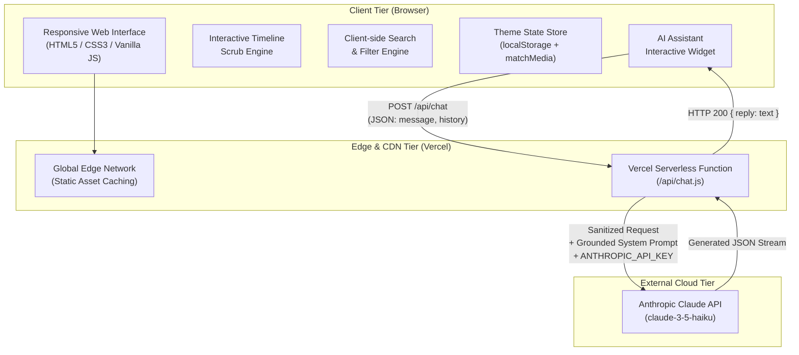
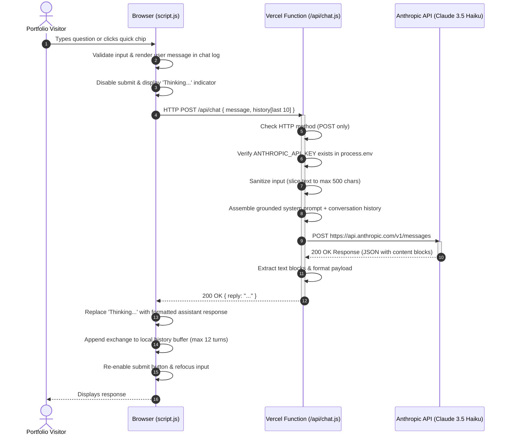
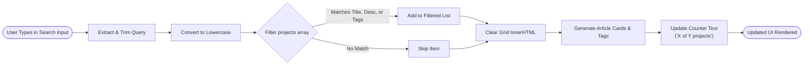
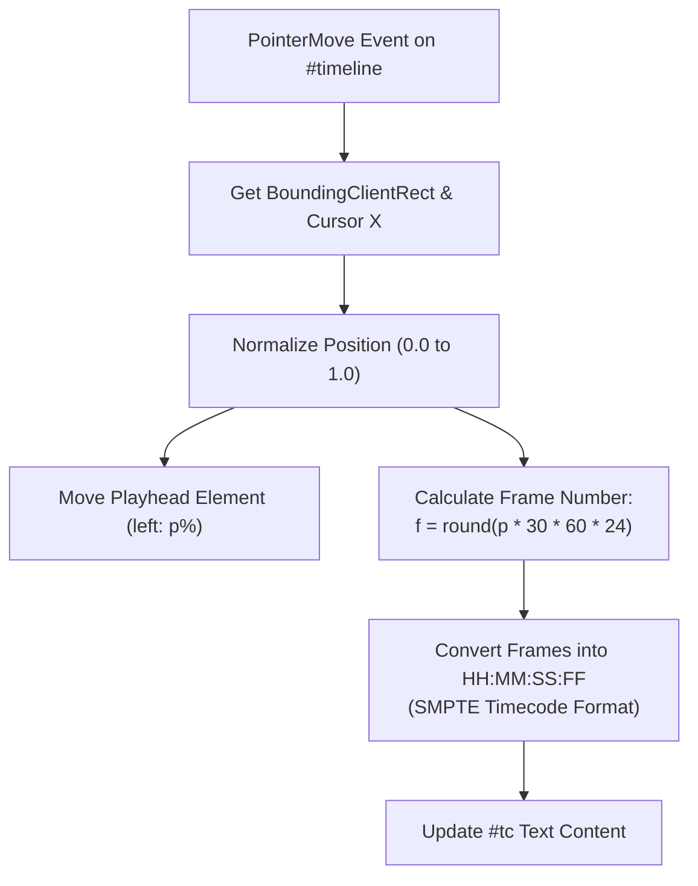
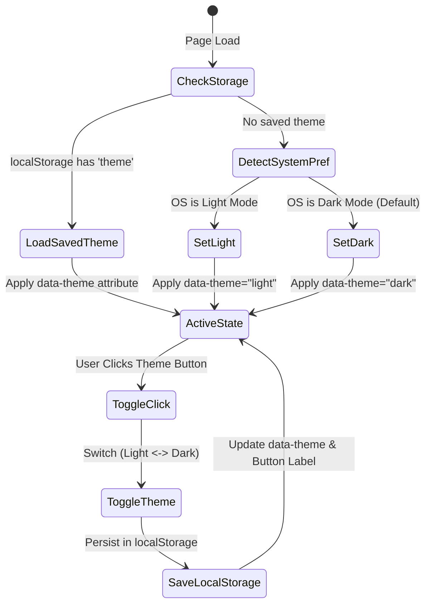

# System Architecture & Design Flow

This document details the architectural design, data flows, security model, and component interactions of **Kush Middha's Portfolio**.

---

## 1. High-Level Architectural Overview

The portfolio is architected as a modern, lightweight hybrid application:
- **Presentation Layer (Frontend)**: Static, zero-dependency, ultra-fast client-side application built with semantic HTML5, modern CSS3 (Custom Properties & CSS Grid/Flexbox), and vanilla JavaScript (ES6+).
- **Compute Layer (BFF / Serverless Gateway)**: A secure Vercel Serverless Function (`/api/chat.js`) that acts as a Backend-For-Frontend (BFF), protecting sensitive credentials and enforcing request validation.
- **AI Intelligence Layer (LLM Service)**: Anthropic Messages API (`claude-3-5-haiku-20241022`) executing grounded prompt inference to answer visitor inquiries accurately.



---

## 2. Data Flow & Sequence Diagrams

### 2.1 AI Assistant Request Flow

The chatbot employs a privacy-first proxy pattern. At no point is the Anthropic API key exposed to the client.



---

### 2.2 Client-Side Instant Search & Filter Flow

The project grid uses an in-memory client-side search engine with multi-field matching (Title, Description, and Technology tags) running at 60 FPS without layout thrashing.



---

### 2.3 Video Timeline Scrubbing Engine

As a video editor and media creator, the hero section showcases an interactive NLE-style (Non-Linear Editor) timeline that visualizes editing tracks and calculates SMPTE timecode dynamically based on cursor pointer coordinates.



---

### 2.4 Theme State Management Flow

The application persists user preference across visits while gracefully honoring system-level OS preferences (`prefers-color-scheme`).



---

## 3. Directory Structure & File Responsibilities

```
portfolio/
├── .env.example          # Environment variable reference template
├── .gitignore            # Excludes secrets, node_modules, and cache files
├── ARCHITECTURE.md       # Architectural blueprints and flow specifications
├── GUIDE.md              # Complete developer setup and deployment guide
├── README.md             # Project overview, quickstart, and features
├── index.html            # Semantic structure, accessibility labels, and metadata
├── style.css             # Design tokens, CSS variables, dark/light theme, typography
├── script.js             # Client state, timeline engine, search filter, and chat client
├── package.json          # Node.js project manifest and developer scripts
├── vercel.json           # Vercel deployment configuration and security headers
├── api/
│   └── chat.js           # Serverless proxy function connecting to Anthropic Claude
└── assets/
    ├── README.md         # Asset instructions
    └── profile.jpg       # Profile picture (placeholder instructions provided)
```

---

## 4. Security & Robustness Highlights

1. **Zero Secret Exposure**: The `ANTHROPIC_API_KEY` is strictly managed within Vercel's server environment. It is never bundled into client-side JS or committed to version control.
2. **Grounding & Jailbreak Mitigation**: The system prompt constrains the model to answer *only* about Kush Middha's background, education, and projects, directing unanswerable queries to LinkedIn or GitHub.
3. **Payload Truncation**:
   - Message character length capped at 500 characters per turn.
   - Conversation history depth capped at 10 items sent to the API, and maximum 12 items retained locally to prevent context bloat and token exhaustion.
4. **Defensive Error Handling**: The frontend handles network timeouts, invalid JSON responses, and HTTP error statuses gracefully, displaying informative feedback without crashing the interface.
5. **Modern Security Headers**: `vercel.json` provides `X-Content-Type-Options: nosniff`, `X-Frame-Options: DENY`, `X-XSS-Protection`, and `Referrer-Policy: strict-origin-when-cross-origin`.
